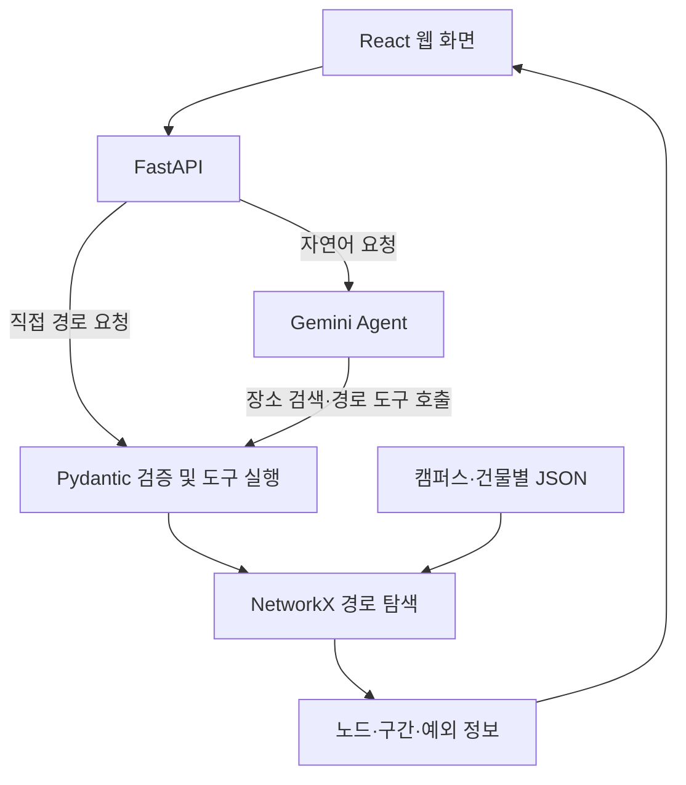

# DAN-GIL | 단길

**길을 잇다, 이동의 문턱을 낮추다.**

DAN-GIL은 단국대학교 죽전캠퍼스의 실외 보행로와 건물 내부 통로를 연결해, 이동 조건에 맞는 길을 찾는 웹 서비스입니다. 학생들 사이에서 ‘포탈’이라고 부르는 평지·엘리베이터·건물 간 연결 통로를 경로 데이터로 구축해, 휠체어나 목발을 사용하는 보행약자가 자신의 상황에 맞는 이동 경로를 찾도록 돕습니다.

건물별 출입구, 복도, 계단, 엘리베이터를 하나의 그래프로 모델링하고, 지도에서 직접 선택하거나 AI 챗봇에 자연어로 요청해 경로를 탐색할 수 있습니다.

2026 이지톤에서 기획·개발한 프로젝트로, Vercel에 배포되어 있습니다.

### [DAN-GIL 바로 이용하기 ↗](https://dangil.vercel.app/)

## 프로젝트 배경

### 알고는 있지만, 이용 방법은 모르는 ‘포탈’

단국대학교 죽전캠퍼스의 경사와 계단은 휠체어나 목발을 사용하는 보행약자에게 이동 부담이 될 수 있습니다. 학생들은 이를 우회하기 위해 평지, 엘리베이터, 건물 간 실내 연결 통로를 활용하는 이동 방법을 ‘포탈’이라고 부릅니다.

하지만 자주 이용하지 않는 건물은 내부 구조와 출입구 위치를 알기 어렵습니다. 포탈의 존재를 알아도 **어디로 들어가고, 어느 층으로 이동하며, 어떤 건물로 연결되는지** 모르면 실제 이동에 활용하기 어렵습니다.

### 연결 정보를 이동 선택지로

DAN-GIL은 이러한 포탈 정보를 누구나 찾아볼 수 있는 경로로 제공하고자 했습니다. **건물 위치뿐 아니라 출입구와 층간 연결까지 경로 데이터에 포함**해, 실외 보행로와 건물 내부를 함께 탐색합니다.

발표에서는 정문에서 곰상까지의 경로를 사례로, 실외 보행로 중심의 안내와 건물 내부 연결을 활용하는 단길의 접근 방식을 비교했습니다. 단길은 사용자의 조건에 따라 평지·엘리베이터·연결 통로를 활용할 수 있도록 안내하며, **보행약자의 이동 선택 범위를 넓히는 것**을 목표로 합니다.

## 팀 소개

**이지톤 20팀 · 김지오, 양인혁, 김민준**

## 주요 기능

| 기능 | 설명 |
| --- | --- |
| 최단 경로 | 등록된 거리 또는 좌표로 계산한 거리를 기준으로 경로 탐색 |
| 계단 없는 경로 | 계단을 제외하고 탐색하며, 연결이 불가능하면 계단 구간 수를 최소화한 대안 안내 |
| 실내 위주 경로 | 실내 연결을 우선하고, 실외 이동이 필요하면 실외 이동 거리의 합을 최소화 |
| AI 챗봇 | 자연어로 출발지·도착지·이동 조건을 입력하고 대화를 통해 장소 확인 |
| 지도 연동 | 카카오맵과 좌표 기반 캠퍼스맵에서 경로 및 출입구 확인 |
| 단계별 이동 안내 | 복도 이동, 계단·엘리베이터 이용, 도착 지점을 순서대로 표시 |
| 예외 구간 표시 | 대안에 포함된 계단이나 실내 위주 경로의 실외 구간을 주황색 계열로 구분 |

> ‘계단 없는 경로’에서 계단이 포함된 대안이 나오는 경우에는 안내 문구와 예외 구간을 확인해 주세요. 챗봇에 ‘계단은 절대 이용할 수 없어’처럼 필수 조건을 전달하면, 해당 조건을 유지하도록 설계되어 있습니다.

## 사용 방법

### 지도에서 직접 찾기

1. [배포 사이트](https://dangil.vercel.app/)에서 **직접 입력** 탭을 선택합니다.
2. 출발지와 도착지를 선택합니다. 지도에서 선택 가능한 장소를 눌러 지정할 수도 있습니다.
3. **계단 없는 경로 / 실내 위주 / 최단 경로** 중 이동 방식을 고릅니다.
4. **경로 찾기**를 누르고 지도와 단계별 이동 안내를 확인합니다.

지도 하단에서 장소 이름 표시를 켜고, 출입구·분기점을 구분해 볼 수 있습니다. 실내의 층간 이동은 경로 안내 목록에서 확인할 수 있습니다.

### 챗봇으로 찾기

**챗봇** 탭에서 출발지, 목적지, 원하는 이동 조건을 입력합니다.

> 정문에서 곰상까지 계단 없이 가고 싶어.
>
> 곰상에서 혜당관까지 실내 위주로 안내해 줘.
>
> 정문에서 곰상까지 가장 짧은 길을 찾아줘.

건물에 출입구가 여러 개 있거나 장소가 명확하지 않으면 챗봇이 추가로 확인합니다. 요청한 층에 등록된 출입구가 없다면 선택 가능한 출입구를 안내합니다. 경로를 찾은 뒤에는 챗봇이 짧게 결과를 알리고, 상세 이동 경로는 지도와 안내 목록에 표시합니다.

## 핵심 설계

### 1. 실내·실외를 연결하는 캠퍼스 그래프

`data/`의 캠퍼스 및 건물별 JSON을 읽어 NetworkX의 양방향 그래프로 통합합니다.

| 구성 요소 | 모델링 대상 |
| --- | --- |
| 노드 | 출입구, 복도, 계단, 엘리베이터, 실외 분기점, 주요 장소 |
| 구간 유형 (`kind`) | 실내 통로 `indoorPath`, 실외 보행로 `outdoorPath` |
| 이동 조건 (`condition`) | 평지 `flat`, 경사 `slope`, 계단 `stair`, 엘리베이터 `elevator` |
| 연결 정보 | 건물 내 층간 이동, 건물 간 연결 통로, 출입구와 실외 보행로 연결 |

출발지와 도착지는 지도에서 선택 가능한 출입구와 주요 장소를 사용합니다. 복도·계단·엘리베이터 노드는 경로 계산 과정에서 중간 연결 지점으로 활용합니다.

### 2. 목적에 따라 달라지는 탐색 기준

세 가지 이동 방식은 서로 다른 기준으로 경로를 평가합니다.

| 방식 | 탐색 기준 |
| --- | --- |
| 최단 경로 | 구간별 `distance_m` 또는 `distance`를 우선 사용하고, 없으면 양 끝 좌표로 거리를 계산합니다. 둘 다 없으면 해당 구간을 탐색에서 제외합니다. |
| 계단 없는 경로 | 계단 구간을 제외한 그래프에서 가중치 기반 경로를 찾습니다. 경로가 없으면 예외 구간 수를 먼저 최소화하고, 같은 예외 수에서는 기본 비용이 작은 경로를 선택합니다. |
| 실내 위주 경로 | 실내만으로 연결되는 경로를 먼저 찾습니다. 연결이 안 되면 `(실외 거리 합, 전체 비용)` 순으로 비교하는 Dijkstra 탐색을 수행합니다. |

실내 위주 탐색에서는 **실외 구간의 개수가 아닌 거리의 합**을 우선합니다. 짧은 실외 구간 여러 개보다 긴 실외 구간 하나가 무조건 유리해지는 문제를 피하기 위한 설계입니다.

가중치 기반 탐색의 기본 비용은 실외 거리 또는 실내 구간 기본값에 이동 조건과 실내·실외 유형별 가중치를 적용한 값입니다. 실제 이동 시간이나 미터 단위 거리와는 구분합니다.

### 3. AI의 요청 해석과 경로 계산 분리

Gemini는 사용자의 대화형 요청에서 출발지, 도착지, 이동 조건을 해석하고, 사전에 정의한 장소 검색 도구와 경로 탐색 도구를 호출합니다. 실제 장소 확인과 경로 계산은 백엔드가 담당합니다. 경로를 언어 모델이 직접 만들어내지 않도록 역할을 분리해, 등록된 그래프와 계산 결과에 근거한 안내를 제공하도록 설계했습니다.



- `search_places`로 확인한 장소 ID만 AI의 `find_route` 호출에 사용할 수 있습니다.
- Pydantic으로 도구 입력과 결과를 검증하고, 노드 순서와 구간 연결의 일치 여부를 확인합니다.
- AI가 재탐색 과정에서 사용자의 제외 조건이나 예외 허용 여부를 임의로 완화하지 않도록 검증합니다.
- 성공한 경로 결과를 프론트엔드에 전달해 직접 검색과 챗봇 검색이 같은 지도·이동 안내를 사용합니다.

## 구현 과정에서 해결한 문제

### 계산상 최적 경로와 사용자가 기대하는 경로의 차이

초기 구현에서는 알고리즘이 선택한 경로가 팀이 예상한 이동 경로와 다르게 나오는 문제가 있었습니다. 이를 해결하기 위해 이동 조건별 가중치와 경로 선택 기준을 조정했습니다.

특히 실내 위주 탐색에서 실외 구간의 **개수**를 기준으로 삼으면, 야외에서 실제로 얼마나 이동하는지를 충분히 반영하지 못했습니다. 실외 구간 수가 적어도 각 구간이 길면 실외 이동 부담은 클 수 있기 때문입니다.

이를 실외 구간의 **거리 합**을 최소화하는 방식으로 수정했습니다. 현재는 실내만으로 연결되는 길을 먼저 탐색하고, 실외 이동이 필요하면 실외 거리 합을 우선 비교한 뒤 전체 비용을 비교합니다. 경로 최적화의 기준을 ‘구간을 몇 개 지나는가’에서 ‘사용자가 실외에서 얼마나 이동하는가’로 구체화한 과정이었습니다.

## 기술 스택

| 영역 | 기술 |
| --- | --- |
| 프론트엔드 | React, JavaScript, Vite, CSS |
| 지도 | Kakao Maps JavaScript SDK, SVG 기반 캠퍼스맵 |
| 백엔드 | Python 3.12+, FastAPI, Uvicorn |
| 경로 탐색 | NetworkX, Dijkstra 기반 탐색 |
| AI | Google Gemini API, Google Gen AI SDK, Function Calling |
| 데이터·검증 | JSON, Pydantic |
| 배포 | Vercel, 프론트엔드 `/api` 요청의 백엔드 연결 |

## 프로젝트 구조

| 경로 | 역할 |
| --- | --- |
| [`frontend/src/CampusExperience.jsx`](frontend/src/CampusExperience.jsx) | 지도, 검색, 챗봇, 이동 안내를 통합한 서비스 화면 |
| [`frontend/src/campusGraph.js`](frontend/src/campusGraph.js) | 지도 표시용 그래프 데이터 및 경로 구간 처리 |
| [`frontend/src/services/`](frontend/src/services/) | 지도 SDK 로딩, 경로·챗봇 API 요청 |
| [`backend/main.py`](backend/main.py) | 장소, 경로, 챗봇 API |
| [`backend/graph.py`](backend/graph.py) | JSON 데이터를 NetworkX 그래프로 통합 |
| [`backend/routing.py`](backend/routing.py) | 장소 검색 및 조건별 경로 탐색 |
| [`backend/agent.py`](backend/agent.py) | Gemini 대화 및 도구 호출 흐름 |
| [`backend/tools.py`](backend/tools.py) | AI 도구 명세, 입력·결과 검증, 경로 탐색 연결 |
| [`data/`](data/) | 캠퍼스 및 건물별 노드·구간 데이터 |
| [`tests/`](tests/) | Agent, 경로 비용, 경로 연동, Gemini 진단 테스트 |

## 로컬 실행

Python 3.12 이상과 Node.js·npm이 필요합니다. 아래 명령은 저장소 루트에서 시작하는 **Windows PowerShell 기준**입니다.

### 1. 백엔드 실행

```powershell
python -m venv .venv
.\.venv\Scripts\python.exe -m pip install -r requirements.txt
```

챗봇을 사용하려면 서버를 실행할 터미널에 Gemini 환경변수를 설정합니다. `GEMINI_MODEL`에는 본인 계정에서 사용할 수 있고 Function Calling을 지원하는 모델 ID를 입력합니다.

```powershell
$geminiSecret = Read-Host "Gemini API 키" -AsSecureString
$env:GEMINI_API_KEY = [System.Net.NetworkCredential]::new("", $geminiSecret).Password
Remove-Variable geminiSecret
$env:GEMINI_MODEL = Read-Host "Gemini 모델 ID"
.\.venv\Scripts\python.exe -m uvicorn backend.main:app --reload
```

Gemini 환경변수 없이도 장소 조회와 직접 경로 탐색은 사용할 수 있습니다. 이 경우 환경변수 설정을 생략하고 Uvicorn 명령만 실행합니다.

### 2. 프론트엔드 실행

새 터미널에서 실행합니다.

```powershell
cd frontend
npm ci
```

`frontend/.env`에 Kakao Maps JavaScript 키를 설정하면 카카오맵을 사용할 수 있습니다. 환경변수 형식은 [`frontend/.env.example`](frontend/.env.example)을 참고하세요.

```dotenv
VITE_KAKAO_MAP_KEY=your_javascript_key
```

키가 없거나 지도 SDK 로딩에 실패하면 좌표 기반 캠퍼스맵을 사용합니다. Gemini API 키는 프론트엔드 환경변수에 넣지 않고 백엔드에만 설정합니다.

```powershell
npm run dev
```

터미널에 표시되는 프론트엔드 주소로 접속합니다. Vite 개발 서버는 `/api` 요청을 `http://127.0.0.1:8000`으로 전달합니다.

### 3. API 및 검증 명령

백엔드 실행 후 [Swagger UI](http://127.0.0.1:8000/docs)에서 API를 확인할 수 있습니다.

| 메서드 | 경로 | 기능 |
| --- | --- | --- |
| `GET` | `/api/health` | 서버 상태 확인 |
| `GET` | `/api/places?endpoints_only=true` | 출발지·도착지로 선택 가능한 장소 조회 |
| `POST` | `/api/routes` | 조건별 경로 탐색 |
| `POST` | `/api/chat` | 챗봇 대화 및 경로 탐색 |

저장소 루트에서 백엔드 테스트를 실행합니다. 테스트에는 Gemini API 키가 필요하지 않습니다.

```powershell
.\.venv\Scripts\python.exe -m unittest discover -s tests -v
```

프론트엔드 빌드 확인:

```powershell
cd frontend
npm run build
```

Gemini 연결에 문제가 있으면 환경변수를 설정한 터미널에서, 저장소 루트를 기준으로 진단 명령을 실행할 수 있습니다.

```powershell
.\.venv\Scripts\python.exe -m backend.check_gemini
```

## 향후 확장 방향

현재 구현 범위는 단국대학교 죽전캠퍼스의 등록된 경로입니다. 앞으로는 같은 그래프 모델링 방식을 활용해 다음 공간으로 적용 범위를 넓히는 것을 구상하고 있습니다.

- **단국대학교 천안캠퍼스 및 타 대학 캠퍼스**: 경사와 계단으로 이동 부담이 큰 공간의 출입구·엘리베이터·연결 통로 정보 구축
- **코엑스와 같은 복합 실내 공간**: 복잡한 층별 구조와 건물 간 연결을 반영한 조건별 길찾기

새로운 공간에 적용하려면 해당 공간의 노드와 연결 정보를 구축하고, 출입 및 시설 이용 조건을 확인하는 작업이 필요합니다.

## 데이터 범위와 안내 기준

- 경로는 저장소에 등록된 장소와 연결 정보를 기준으로 계산합니다. 모든 건물·강의실을 지원하는 것은 아닙니다.
- 좌표 기반 거리는 실제 보행로의 굴곡과 고도 차이를 모두 반영한 실측 거리가 아닙니다. 거리 정보가 없는 연결은 최단 경로 모드에서 제외되므로, 다른 모드에서 연결되는 장소도 최단 경로에서는 결과가 없을 수 있습니다.
- 계단이 없는 경로가 휠체어 통행 가능성을 보장하지는 않습니다. 출입구 폭, 경사도, 시설 운영 상태 등은 별도로 확인해야 합니다.
- 실시간 위치 추적이나 통로 폐쇄·엘리베이터 운영 상태의 실시간 반영은 제공하지 않습니다.
- 챗봇은 Gemini API 설정과 사용량 제한의 영향을 받습니다. 챗봇 요청이 제한되어도 직접 경로 찾기는 별도로 이용할 수 있습니다.
